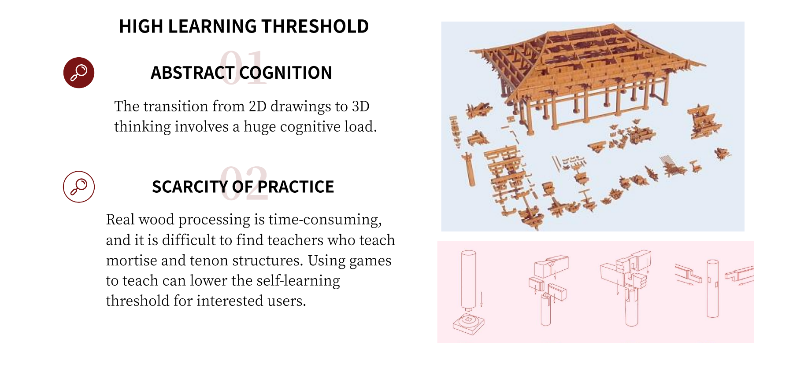
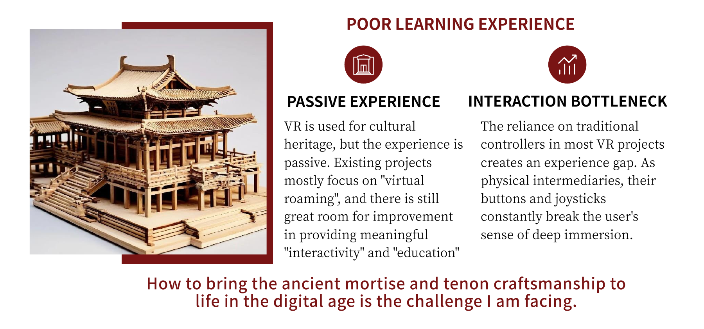
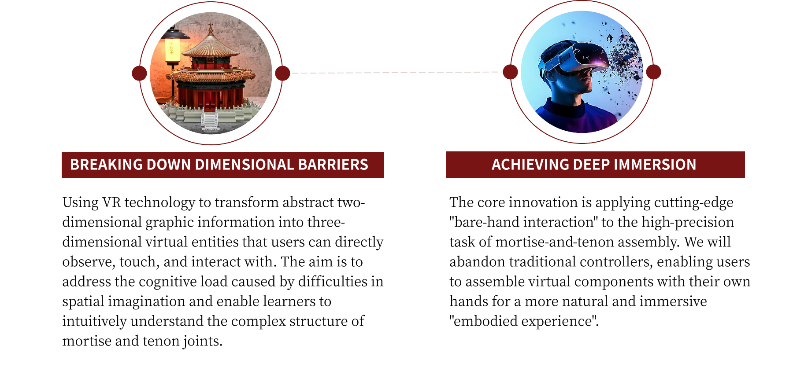
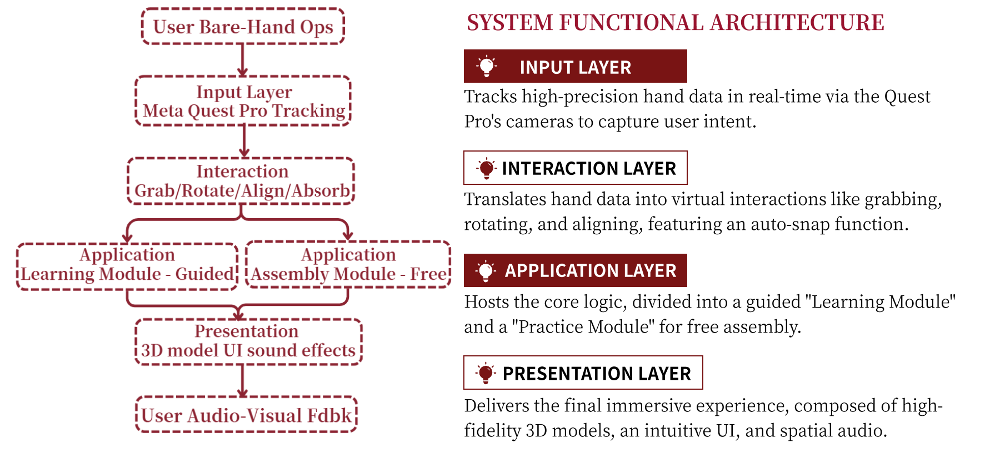
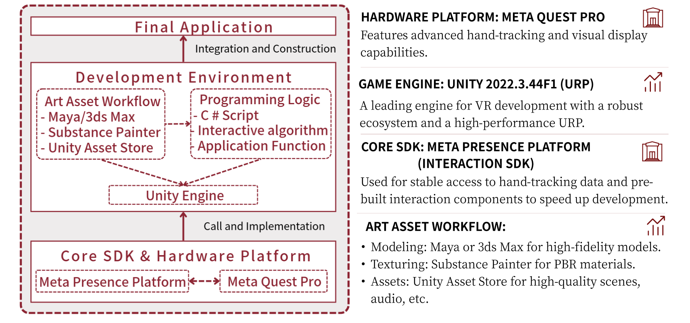
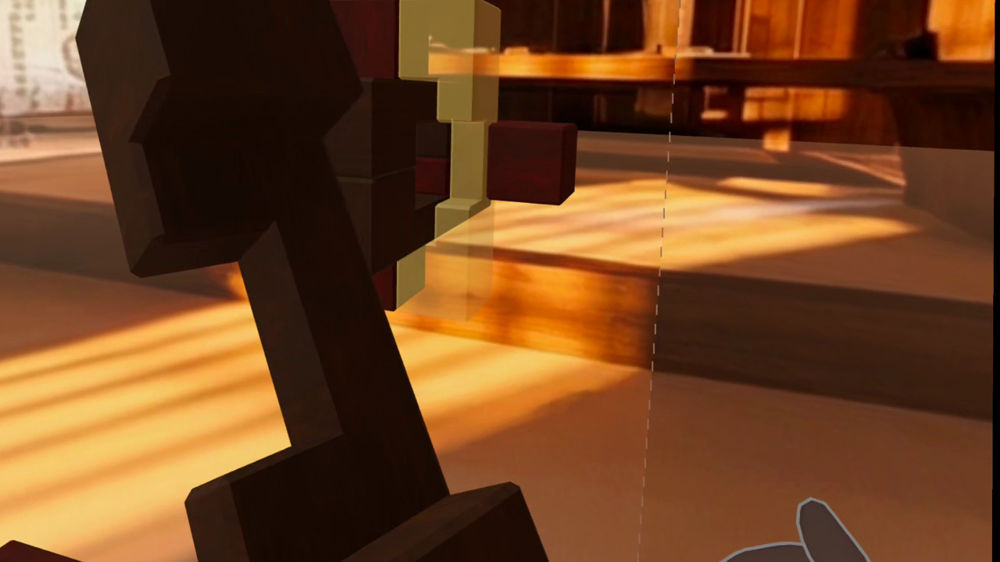
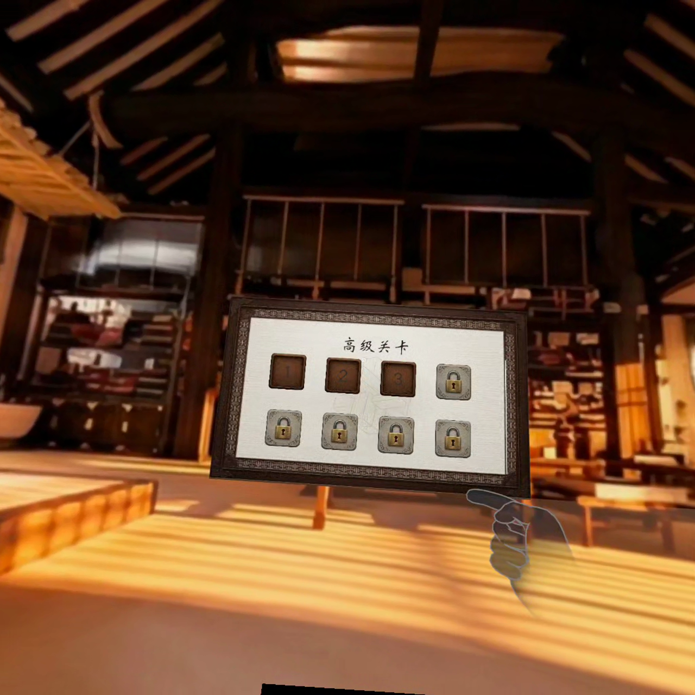
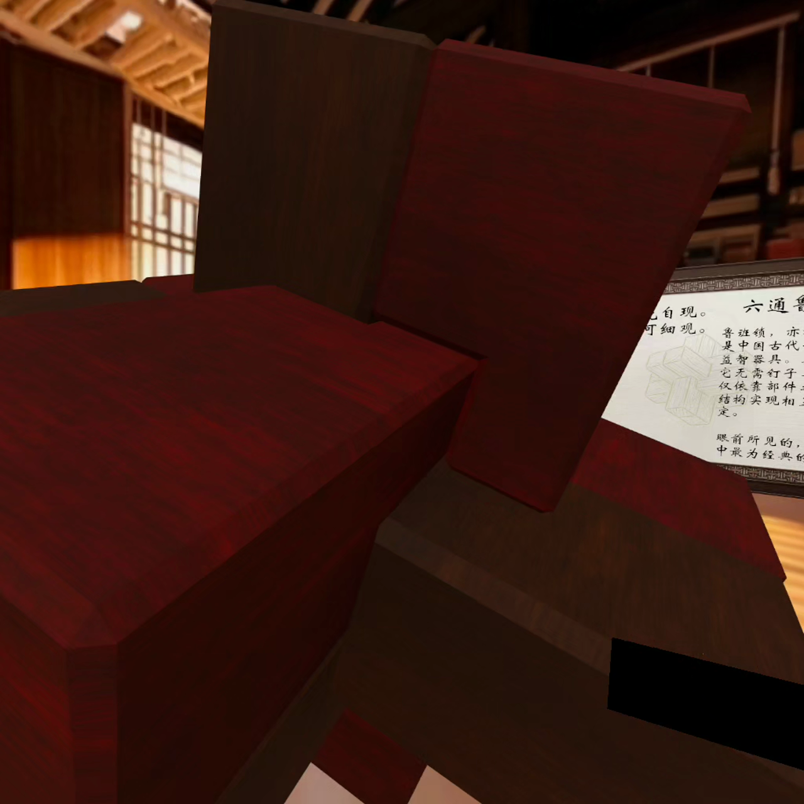

# 巧木天工：VR 榫卯结构拼装体验

一个面向榫卯结构认知与空间理解的 VR 沉浸式拼装原型。项目把传统木构件拆解为可观察、可抓取、可旋转、可对齐的三维零件，用户可以在虚拟空间中完成从认识结构到自由拼装的完整流程。

## 项目概览

- **项目类型**：VR 交互体验 / 数字化传统工艺 / 教学型游戏原型
- **核心设备**：Meta Quest Pro
- **开发引擎**：Unity 2022.3（URP）
- **交互框架**：Meta Presence Platform / Interaction SDK
- **关键能力**：手部追踪、裸手抓取、微手势导航、旋转与对齐、自动吸附、空间音效、模块化教学流程

## 设计目标

传统榫卯学习通常依赖二维图纸或实体木作，初学者需要在脑中完成从平面信息到三维结构的转换，理解成本较高。项目以 VR 的空间呈现和自然手部交互降低认知门槛，让用户能够直接观察结构关系，并通过实际拼装建立对构件位置和连接方式的理解。

## 核心体验

1. **认识结构**：查看建筑构件与榫卯连接关系，理解零件的形态和装配方向。
2. **引导学习**：在提示与自动吸附辅助下完成分步拼装，减少初次操作的挫败感。
3. **自由练习**：进入自由拼装模块，自主抓取、旋转、移动并组合构件。
4. **结果反馈**：通过模型状态、界面提示与空间音效反馈装配结果，强化操作确认感。

## 交互设计

- 使用裸手抓取替代传统控制器输入，缩短用户与虚拟构件之间的操作距离。
- 融合“宏观物理抓取 + 微观手势导航”的混合交互范式：手部负责构件操作，指尖微动负责菜单导航和高频指令，减少长时间悬空操作带来的疲劳。
- 基于时空图卷积网络（ST-GCN）识别指尖微手势，并在 Meta Quest Pro 端进行轻量化推理。
- 将抓取、旋转、对齐、吸附拆成连续动作，保持操作逻辑直观。
- 对高精度拼装提供自动吸附与位置校正，兼顾真实感和可用性。
- 采用“引导学习 + 自由练习”的双模块结构，使用户先建立规则，再进行自主探索。

## 微手势交互与量化结果

项目针对 VR 装配中的“悬空操作疲劳”和菜单导航效率问题，引入微手势交互，并通过性能测试与用户对比实验进行验证：

- **实时性**：微手势识别模型单次推理延迟为 **14.2 ms**；系统在标准负载下稳定运行于 **72 FPS**。
- **效率**：12 名受试者的任务完成时间由传统悬空点击的 **215.4 s** 缩短至 **168.7 s**，操作效率提升 **21.6%**。
- **舒适度**：NASA-TLX 体力需求评分由 **78.5** 降至 **25.4**，体力负荷降低约 **67.6%**；努力程度评分由 **70.8** 降至 **34.7**。
- **反馈质量**：挫败感评分由 **65.2** 降至 **20.6**，自评表现由 **59.6** 提升至 **80.3**。

上述结果说明，微手势导航在保持交互实时性的同时，能够减少大幅悬空动作，改善长时使用的舒适度，并提升频繁界面操作的完成效率。

## 技术实现

- 通过 Meta Quest 的手部追踪数据获取用户意图。
- 使用 Interaction SDK 处理抓取、双手交互和交互状态管理。
- 在 Unity 中组织构件、交互逻辑与展示层，支持模块化场景迭代。
- 结合三维模型、界面、音效和自动吸附逻辑，形成可完整体验的交互闭环。

## 项目展示

### 设计问题与体验目标

### 交互体验方向

### 核心创新点

### 系统功能架构

### 开发环境与技术栈

### 实际运行场景

以下截图来自项目运行录屏，展示构件抓取、关卡导航和古风场景中的沉浸式交互：

## 演示构建

仓库不直接存放大型二进制文件。Android 演示构建 `democap.apk` 已放入 GitHub Release，适合在对应的 Meta Quest 测试环境中体验。

- [下载演示构建（Release）](../../releases/latest)
- [观看带字幕项目讲解视频（MP4）](../../releases/download/v1.0-demo/qiaomu-tiangong-demo-subtitled.mp4)

由于设备、SDK 和运行时版本可能影响兼容性，建议在 Meta Quest 设备及相应开发环境中测试。当前仓库主要用于作品集展示，未包含完整 Unity 源工程及第三方依赖缓存。

## 仓库内容

- `cover.png`：项目封面
- `overview-*.png`：项目目标、交互方案、系统架构与技术栈说明图
- `scene-*.png`：项目运行场景截图
- `通榫.stl`：榫卯模型素材示例
- GitHub Release：Android 演示构建与带字幕项目讲解视频

